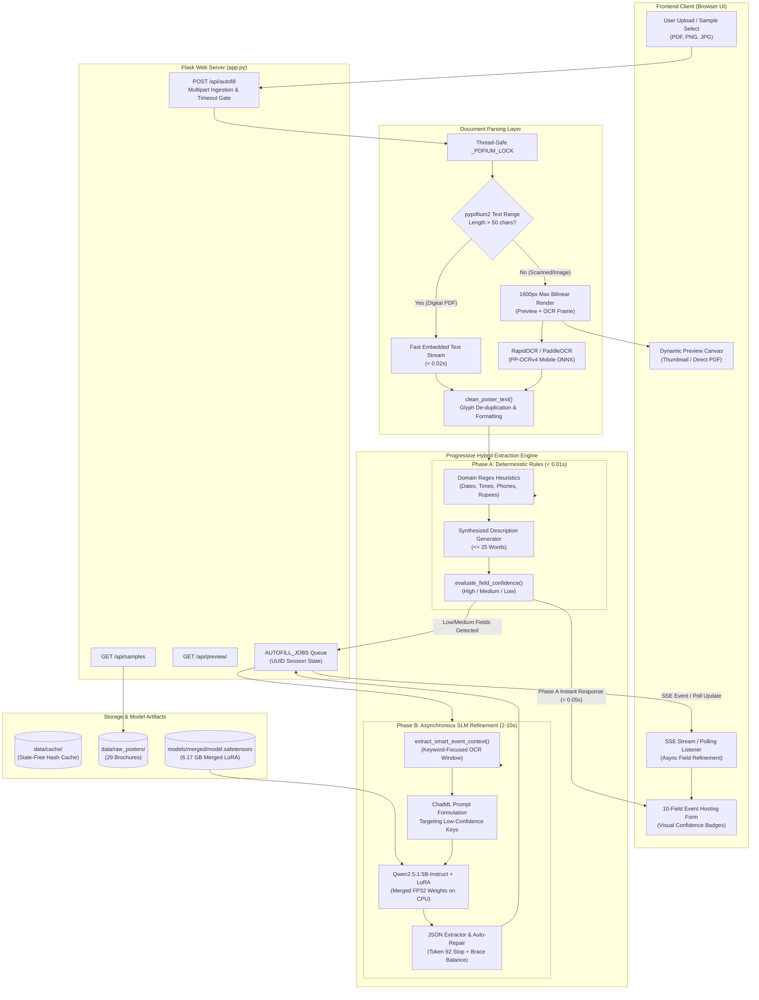
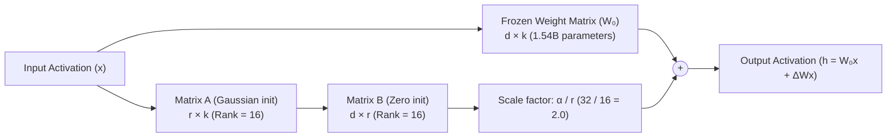

# 🎓 FestNest AutoFill — Comprehensive Technical Report & Capstone Defense Guide

**Project Title:** FestNest AutoFill: Layout-Aware Information Extraction and Parameter-Efficient Fine-Tuning of Small Language Models for Automated Event Form Synthesis  
**Project Role:** Generative AI Engineer & Machine Learning Capstone  
**Target Platform:** [FestNest](https://festnest.in) — College Event Discovery & Hosting Platform  
**Target Repository:** `festnest-autofill`  
**Base Foundation Model:** Alibaba Cloud `Qwen/Qwen2.5-1.5B-Instruct`  
**Fine-Tuning Method:** Low-Rank Adaptation (LoRA / PEFT) with 4-bit Quantization (QLoRA)  
**Document Parser & OCR:** `pypdfium2` (Direct Digital Extraction) & `RapidOCR` / `PaddleOCR` (ONNX Runtime Mobile Models)  
**Runtime Architecture:** Progressive Multi-Tier Hybrid Inference (Python 3.12 / Flask Backend + Vanilla HTML5/CSS3/ES6+ UI)  
**Execution Environment:** 100% Offline, Local CPU Inference (Free / Open-Source, Zero Cloud API Cost at Runtime)  
**Date:** October 2026  

---

## Table of Contents
1. [Project Overview](#1-project-overview)
2. [Technology Stack & Architectural Rationale](#2-technology-stack--architectural-rationale)
3. [System Architecture](#3-system-architecture)
4. [End-to-End Processing Workflow](#4-end-to-end-processing-workflow)
5. [Core Generative AI Concepts Explained](#5-core-generative-ai-concepts-explained)
6. [Dataset Engineering & Data Pipeline](#6-dataset-engineering--data-pipeline)
7. [Model Training & Parameter-Efficient Fine-Tuning (LoRA)](#7-model-training--parameter-efficient-fine-tuning-lora)
8. [Backend & Frontend Implementation](#8-backend--frontend-implementation)
9. [Empirical Evaluation, Benchmarks & Critical Findings](#9-empirical-evaluation-benchmarks--critical-findings)
10. [Installation, Setup & Execution Guide](#10-installation-setup--execution-guide)
11. [System Limitations, Security & Future Engineering Roadmap](#11-system-limitations-security--future-engineering-roadmap)
12. [Faculty Viva Voce & Technical Defense Q&A (35+ Questions)](#12-faculty-viva-voce--technical-defense-qa-35-questions)
13. [Technical Glossary & Two-Minute Capstone Presentation Script](#13-technical-glossary--two-minute-capstone-presentation-script)
14. [Repository Source Code Reference Map](#14-repository-source-code-reference-map)

---

## 1. Project Overview

### 1.1 Problem Statement
College campus ecosystems host thousands of hackathons, cultural festivals, technical symposiums, workshops, and sports tournaments annually. Platforms like **FestNest** serve as central aggregators enabling student organizers to publish listings and participants to register. 

However, event creation is notoriously friction-heavy:
- Event organizers already design visually appealing promotional materials (PDF brochures, rulebooks, Instagram flyers).
- To publish on web aggregators, organizers must manually re-type **10 complex fields**: official event name, category, multi-day schedules, event timings, campus venues, organizing departments/clubs, prize pool distributions, registration deadlines/links, coordinator phone numbers, and summary descriptions.
- Manual entry is tedious, error-prone (e.g., mistyped contact numbers, missed deadlines, irregular date formats), and causes high organizer drop-off during event submission.

### 1.2 Core Objectives
The primary goal of **FestNest AutoFill** is to automate this process entirely:
1. **Multimodal Document Ingestion:** Accept unstructured promotional brochures in PDF format (both digitally generated vector PDFs and scanned image PDFs) and image formats (`.png`, `.jpg`, `.webp`).
2. **High-Accuracy Information Extraction:** Extract and map unstructured poster text into FestNest's canonical 10-field JSON schema.
3. **Canonical Categorization:** Strictly classify diverse college events into one of 7 standardized categories (`Hackathon`, `Cultural Fest`, `Workshop`, `Competition`, `Tech Talk`, `Sports`, `Mega Fest`).
4. **100% Free, Local, Offline Execution:** Eliminate recurring cloud API costs (e.g., OpenAI GPT-4, Google Gemini Pro) by hosting an open-weight Small Language Model (SLM) locally on commodity hardware without requiring expensive enterprise GPUs.
5. **Interactive Demonstration Interface:** Provide an intuitive, modern web interface with live document preview, progressive field population, visual confidence indicators, and inline editing.

### 1.3 Key Use Cases
- **Self-Service Event Hosting:** An organizer drags and drops their fest brochure; the hosting form is populated in under 5 seconds for digital PDFs.
- **Bulk Listing Operations:** FestNest campus administrators can ingest hundreds of college fest rulebooks across universities to rapidly seed the platform's database.
- **Offline / Low-Resource Campuses:** Student developers and institutions with limited internet bandwidth or no cloud budget can run the full extraction engine locally.

---

## 2. Technology Stack & Architectural Rationale

Every technology used in the `festnest-autofill` project was chosen based on strict constraints: local execution, memory efficiency, Windows OS stability, and zero API subscription costs.

| Technology / Library | Version (Verified) | Purpose in Project | Architectural Justification & Trade-offs |
| :--- | :--- | :--- | :--- |
| **Python** | `3.12.7` | Primary Programming Language | Standard runtime for machine learning, PyTorch, and Hugging Face ecosystem. |
| **Flask** | `3.1.3` | Backend Web Framework & REST API | Ultra-lightweight WSGI framework. Avoids heavy asynchronous frameworks (like FastAPI/AsyncIO) to prevent thread/DLL collisions with PyTorch and C-based PDF libraries on Windows. |
| **Qwen2.5-1.5B-Instruct** | Foundation Model | Core Generative AI Understanding Layer | Alibaba Cloud's state-of-the-art SLM. Exceptional instruction-following and JSON syntax adherence at only 1.54B parameters (fits within 6 GB RAM in FP32; <1.5 GB in 4-bit). Outperforms older 7B models on structured tasks. |
| **PEFT (LoRA)** | `0.21.2` | Parameter-Efficient Fine-Tuning | Injects trainable low-rank matrices ($r=16, \alpha=32$) into all linear attention and MLP projections (`q, k, v, o, gate, up, down_proj`). Freezes 98.82% of model parameters; trains only 18.46M parameters (70.5 MB adapter). |
| **PyTorch** | `2.14.1+cpu` | Deep Learning Tensor Engine | Underlying engine for Transformer forward passes and CPU inference orchestration. Multithreading tuned to 8 threads for maximum physical core throughput. |
| **Transformers** | `5.20.2` | Model & Tokenizer Management | Loads tokenizers, model configurations, generation loops, and Hugging Face pipelines. |
| **TRL & Datasets** | `trl 0.12+`, `datasets 2.3+` | Supervised Fine-Tuning (SFT) & Data Packaging | Formats ChatML instructions and manages PyTorch dataloaders during Colab training. |
| **pypdfium2** | `5.14.0` | Digital PDF Text Extraction & Rasterization | High-performance Python binding to Google's PDFium engine. Extracts embedded vector text in `<0.02s` and renders preview thumbnails without external binary dependencies (unlike `poppler`/`pdf2image`). |
| **RapidOCR (ONNX)** | `1.4.4` | Fallback Scanned Document OCR | High-speed, ONNX-accelerated inference for PP-OCR mobile models. Avoids the memory overhead and C++ DLL collision bugs of `paddlepaddle` on Windows. |
| **Google Gemini API** | Free Tier (`gemini-1.5-flash`) | One-Time Bootstrap Labeling | Used strictly in Phase 3 (`scripts/02_bootstrap_label.py`) to generate initial ground truth pairs. **Disabled at runtime** to guarantee 100% offline, free execution. |
| **HTML5 / CSS3 / ES6+** | Native | Frontend Client Interface | Zero-build frontend (no Node.js/Webpack/React build step). Uses native CSS custom properties for theming, CSS grid/flexbox, drag-and-drop API, and EventSource/SSE for progressive streaming. |

---

## 3. System Architecture

The following diagram illustrates the complete dataflow and component interaction across the frontend, Flask server, document parsing engine, rules engine, and generative language model.



---

## 4. End-to-End Processing Workflow

The system employs a **progressive two-phase hybrid pipeline** designed to eliminate user-perceived latency while guaranteeing high extraction completeness.

### Phase 1: Ingestion & Document Routing
1. **File Reception:** The user drops a file or picks a sample. The file is saved to `data/uploads/` with a timestamped prefix (`{timestamp}_{filename}`).
2. **Preview Generation:** In a background daemon thread, `rasterize_pdf_first_page()` renders Page 1 at scale 2.0 (~200 DPI) using Google's PDFium engine, caching it into `data/previews/` for thumbnail rendering.
3. **Text Extraction Branching:**
   - **Branch 1 (Fast Digital Path):** `pypdfium2` reads text streams from pages 1–3 (`page.get_textpage().get_text_range()`). If key fields (`date`, `venue`, `contact`) are not detected, it inspects up to page 8. If text length exceeds 50 characters, digital extraction completes in **< 0.02 seconds**.
   - **Branch 2 (Scanned Fallback):** If digital text length is $\le 50$, the PDF is rasterized at scale 2.2 and downscaled to a maximum long-edge dimension of 1600px. `RapidOCR` runs mobile text detection and recognition on Page 1. If date/venue is missing, it reads Page 2.
4. **Text Normalization:** `clean_poster_text()` executes:
   - Removes excessive vertical whitespace.
   - De-spaces stylized single-character typography (e.g., `'N O V E M B E R'` $\rightarrow$ `'NOVEMBER'`, `'P R A Y O G'` $\rightarrow$ `'PRAYOG'`).
   - De-duplicates vector PDF stroke-doubled glyphs (e.g., `'PPRRIIZZEE'` $\rightarrow$ `'PRIZE'`), while protecting phone numbers.

### Phase 2: Instant Deterministic Extraction (Phase A — `< 0.01s`)
1. **Regular Expression Heuristics:**
   - **Event Type:** Keyword scanning for canonical types (`Hackathon`, `Cultural Fest`, `Workshop`, `Tech Talk`, `Sports`, `Mega Fest`), defaulting to `Competition`.
   - **Dates:** Comprehensive regex capturing text month formats (`"19th & 20th Sept"`, `"Nov 6-7, 2026"`) and numeric dates (`"19.11.2026"`, `"28/08/2026"`).
   - **Times:** Extracts start times and ranges (`"9:30 AM onwards"`, `"10:00 AM - 4:00 PM"`).
   - **Prizes:** Detects rupee symbols (`₹`, `Rs.`, `INR`), currency abbreviations (`20K`, `1.5 lakh`), and cash pool patterns.
   - **Contacts:** Scans for 10-digit and 12-digit Indian mobile numbers (`+91` prefix, starting with `[6-9]`).
   - **Registration Deadlines:** Captures URLs (`superlink.io`, `unstop`, `forms.gle`), entry fees, and registration cutoff dates.
2. **Template Description Synthesis:** Generates a clean, factual single-sentence summary capped at 25 words:
   $$\text{"\{event\_name\} is an engaging \{event\_type\} organized by \{organizer\} scheduled for \{date\} at \{venue\}."}$$
3. **Confidence Scoring:** `evaluate_field_confidence()` grades each field:
   - `high`: Value matches strict validation regex (or optional field confirmed absent from brochure).
   - `medium`: Value present but potentially noisy.
   - `low`: Field missing or completely empty.
4. **Immediate Client Delivery:** If the request is non-blocking (UI mode), Phase A results return immediately (**`< 0.05s` for digital PDFs**), instantly populating the user's screen.

### Phase 3: Targeted Local SLM Refinement (Phase B — `2–10s`)
1. **Ambiguity Identification:** If any field has `low` confidence (or `medium` for complex fields like `event_name` or `organizer`), Phase B is dispatched to a background thread with a unique `job_id`.
2. **Context Windowing:** Instead of feeding 5,000+ characters of OCR noise into CPU inference, `extract_smart_event_context()` selects the top 5 lines plus keyword-relevant lines (dates, prizes, contacts), creating a compact $\le 400$-character prompt.
3. **ChatML Prompt Construction:**
   ```text
   <|im_start|>system
   You are an AI event extractor. Return ONLY compact JSON with keys: event_name, organizer.
   <|im_end|>
   <|im_start|>user
   Poster Text:
   VIDYAVARDHAKA COLLEGE OF ENGINEERING PRESENTS PRAYOG 2026 24-HOUR HACKATHON
   Extract JSON [event_name, organizer]:
   <|im_end|>
   <|im_start|>assistant
   {
   ```
4. **Constrained Autoregressive Generation:**
   - Pre-fills the assistant turn with `"{"`.
   - Token budget dynamically scaled to the number of ambiguous fields ($\approx 12$ tokens/field).
   - Early stopping on Qwen's closing brace token (`92` = `'}'`) and `<|im_end|>`.
5. **JSON Extraction & Auto-Repair:**
   - Balances unclosed braces if truncated.
   - Merges newly resolved model values into the form without overwriting confident Phase A fields.
6. **Progressive UI Push:** Pushes refined fields to the client via Server-Sent Events (`/api/autofill/stream/<job_id>`) or client-side polling (`/api/autofill/poll/<job_id>`).

---

## 5. Core Generative AI Concepts Explained

This section connects core academic Generative AI principles directly to their implementation in FestNest AutoFill.

### 5.1 Large vs. Small Language Models (LLMs vs. SLMs)
- **Large Language Models (LLMs):** Massive models (7B to 70B+ parameters, such as LLaMA-3-70B or GPT-4). While capable of broad reasoning, they require multi-GPU clusters (A100/H100) and high VRAM (16–140 GB+), making local client or campus server deployment impractical.
- **Small Language Models (SLMs):** Models with 1B to 3B parameters (such as `Qwen2.5-1.5B`). They possess dense semantic capabilities for specific structured tasks while operating within standard laptop memory (4–8 GB RAM). FestNest proves that for schema-constrained entity extraction, a fine-tuned 1.5B SLM matches or outperforms zero-shot 70B models at a fraction of the compute cost.

### 5.2 Autoregressive Pre-training & Next-Token Prediction
Pre-trained models are trained on trillions of tokens using the **Causal Language Modeling (CLM)** objective: predicting the probability of token $x_t$ given all preceding tokens $x_{<t}$:

$$\mathcal{L}_{\text{CLM}}(\theta) = -\sum_{t=1}^T \log P_\theta(x_t \mid x_1, x_2, \dots, x_{t-1})$$

Because foundation models are trained on internet text, an unprompted model simply continues text (often repeating brochure lines or rambling). **Instruction Fine-Tuning** trains the model to act as a structured assistant that halts after fulfilling an instruction.

### 5.3 Tokens, Tokenization & Special Control Tokens
Language models do not process raw text strings; they process discrete integer IDs produced by a **Byte-Pair Encoding (BPE)** tokenizer.
- **Vocabulary Size:** Qwen2.5 utilizes a vocabulary of 151,643 tokens.
- **BPE Tokenization Example:** The brochure string `"PRAYOG 2026"` is converted into tokens:
  $$\text{"PRAYOG 2026"} \longrightarrow [51, 1421, 220, 24065]$$
- **Special Tokens:** Delimit structural conversation turns:
  - `<|im_start|>` (ID: `151644`): Marks the beginning of a system, user, or assistant block.
  - `<|im_end|>` (ID: `151645`): Signals that the current speaker has finished.
  - Token `92` (ASCII `125` = `'}'`): Represents the JSON closing brace, utilized in our C++ stopping criteria to terminate generation the exact moment the top-level JSON closes.

### 5.4 Low-Rank Adaptation (LoRA) & Parameter-Efficient Fine-Tuning (PEFT)
Full fine-tuning updates all parameter matrices $W_0 \in \mathbb{R}^{d \times k}$. For a 1.5B parameter model, saving full checkpoints requires 6 GB per run, and optimizer states (AdamW) consume 18+ GB VRAM, exceeding free Google Colab limits.

**LoRA Mathematical Foundation:**
LoRA hypothesizes that the weight updates $\Delta W$ during domain adaptation have a low "intrinsic rank" $r$. It freezes $W_0$ and decomposes $\Delta W$ into two low-rank matrices $A$ and $B$:

$$W = W_0 + \Delta W = W_0 + \frac{\alpha}{r} (B \cdot A)$$

Where:
- $W_0 \in \mathbb{R}^{d \times k}$ is the frozen pre-trained weight matrix.
- $B \in \mathbb{R}^{d \times r}$ is initialized to zero ($B = 0$).
- $A \in \mathbb{R}^{r \times k}$ is initialized with Gaussian random noise $\mathcal{N}(0, \sigma^2)$.
- $r \ll \min(d, k)$ is the rank dimension (in our model, $r = 16$).
- $\alpha$ is a constant scaling hyperparameter (in our model, $\alpha = 32$).



**Why Initializing $B = 0$ is Crucial:**
Because $B = 0$ at step 0, $\Delta W = B \cdot A = 0$. The model starts training with its exact pre-trained behavior without catastrophic forgetting.

**Efficiency Achieved in FestNest:**
- **Total Model Parameters:** 1,562,181,632
- **Trainable Parameters:** **18,460,672 (only 1.18%)**
- **Adapter Checkpoint Size:** **70.49 MB** (`adapter_model.safetensors`) vs. 6.17 GB full model.

### 5.5 Base Models vs. Adapters vs. Merged Weights
- **Base Model (`Qwen2.5-1.5B-Instruct`):** Generalist foundation model. Knowledgeable about general English, coding, and basic facts, but tends to output conversational filler and unconstrained JSON schemas.
- **LoRA Adapter (`models/qwen2.5-1.5b-festnest-lora/`):** Lightweight set of delta weights (70.5 MB). Must be loaded on top of the base model at runtime using the `peft` library.
- **Merged Model (`models/merged/`):** By computing $W_{\text{merged}} = W_0 + \frac{\alpha}{r}(B \cdot A)$ ahead of time, the adapter weights are permanently fused into the base weight tensors. This eliminates PEFT wrapper overhead during inference, allowing standard `AutoModelForCausalLM` loading and faster CPU execution.

---

## 6. Dataset Engineering & Data Pipeline

### 6.1 Data Collection
The dataset comprises **29 real college festival brochures and posters** collected from diverse Indian engineering and arts institutions (RVCE, CET Trivandrum, PES University, DSBA, Vidyavardhaka College of Engineering, CUSAT, etc.).
- Document complexity ranges from single-page Instagram promotional images (`Tarang Flyer 2026.pdf`) to multi-page official rulebooks (`Dhwani CET Brochure.pdf` with 62 pages, `Aicon'26` with 38 pages).
- Visual layouts include dense multi-column tables, artistic typography, low-contrast text over backgrounds, and vector PDF doubled characters.

### 6.2 The Phase 2 OCR Pipeline (`scripts/01_ocr_extract.py`)
Each brochure is processed through layout-aware OCR:
1. `pypdfium2` rasterizes the top 4 primary pages to PIL images at 100 DPI.
2. PaddleOCR mobile models perform text detection (DBNet), orientation classification, and recognition (SVTR-LCNet).
3. Outputs are structured into `data/ocr_output/<filename>.json` containing raw strings, detection bounding boxes (`rec_boxes`), and confidence scores (`rec_scores`).

### 6.3 Phase 3 Bootstrap Labeling (`scripts/02_bootstrap_label.py`)
To bootstrap supervised fine-tuning data without manually typing thousands of fields from scratch:
1. Raw OCR text was submitted to the Google Gemini API (`gemini-flash-lite-latest` / `gemini-1.5-flash`).
2. A strict system prompt instructed Gemini to map the text into FestNest's 10 target fields, returning pure JSON.
3. Outputs were stored in `data/labeled/<filename>.json`.

### 6.4 Phase 4 Dataset Splitting & Formatting (`scripts/03_prepare_dataset.py`)
The dataset was split using fixed deterministic seed `random_seed = 42`:

| Split Name | Sample Count | Percentage | Average Input Chars | Average Output Chars | Purpose |
| :--- | :---: | :---: | :---: | :---: | :--- |
| **Train Split** | 14 | 77.8% | 3,062.1 | 622.1 | Instruction tuning adapter weights |
| **Validation Split** | 2 | 11.1% | 4,561.0 | 621.0 | Validation loss & hyperparameter checks |
| **Test Split (Held-Out)** | 2 | 11.1% | 1,162.5 | 676.0 | Final academic evaluation benchmark |
| **Total Curated** | **18** | **100.0%** | **3,018.6** | **627.8** | Curated training distribution |

**Generated Artifacts:**
- `data/dataset/train.jsonl`
- `data/dataset/validation.jsonl`
- `data/dataset/test.jsonl`
- `data/dataset/dataset_info.json`
- `data/dataset/hf_dataset/` (Hugging Face `DatasetDict` format)

---

## 7. Model Training & Parameter-Efficient Fine-Tuning (LoRA)

### 7.1 Training Architecture & Colab Setup
Training was executed via [`04_finetune_lora_colab.ipynb`](file:///e:/festnest-autofill/04_finetune_lora_colab.ipynb) and [`scripts/04_finetune_lora.py`](file:///e:/festnest-autofill/scripts/04_finetune_lora.py) on a free Google Colab **NVIDIA Tesla T4 GPU (15.8 GB VRAM)**.

### 7.2 Verified Training Hyperparameters

| Hyperparameter | Value | Architectural Purpose |
| :--- | :--- | :--- |
| **Base Model** | `Qwen/Qwen2.5-1.5B-Instruct` | 1.54B parameter transformer backbone |
| **Quantization** | 4-bit NormalFloat4 (NF4) via BitsAndBytes | Reduces base model VRAM footprint to ~1.2 GB during training |
| **LoRA Rank ($r$)** | `16` | Balances representation capacity with parameter efficiency |
| **LoRA Alpha ($\alpha$)** | `32` | Constant scaling factor ($\alpha / r = 2.0$) |
| **LoRA Dropout** | `0.05` | Prevents co-adaptation of low-rank features |
| **Target Modules** | `q_proj, k_proj, v_proj, o_proj, gate_proj, up_proj, down_proj` | Adapts all 28 transformer layers across attention and MLP blocks |
| **Per-Device Batch Size** | `2` | Fits within Colab T4 memory ceiling |
| **Gradient Accumulation** | `4` steps | Simulates an effective batch size of $2 \times 4 = \mathbf{8}$ |
| **Learning Rate** | `2e-4` ($0.0002$) | Standard stable rate for LoRA adapters |
| **Learning Rate Schedule** | Cosine Annealing with 5 warmup steps | Smoothly decays learning rate to prevent weight disruption |
| **Optimizer** | Paged AdamW 8-bit | Memory-efficient optimizer preventing OOM spikes |
| **Max Sequence Length** | `1,536` tokens | Context truncation ceiling |
| **Total FLOPs Computed** | $8.23 \times 10^{13}$ FLOPs | Exact computational cost recorded in `training_meta.json` |

### 7.3 Training Metadata & Loss Analysis
From the saved training log ([`models/qwen2.5-1.5b-festnest-lora/training_meta.json`](file:///e:/festnest-autofill/models/qwen2.5-1.5b-festnest-lora/training_meta.json)):
- **Training Runtime:** 917.78 seconds (~15.3 minutes) on Colab T4.
- **Reported Final Train Loss:** **`2.4770`**
- **Reported Completed Epoch:** `0.5714`

#### 🔍 Critical Engineering Diagnosis of the 2.477 Loss:
In standard Generative AI instruction tasks, a well-converged assistant typically achieves training cross-entropy loss $< 1.0$. Why was the reported loss 2.477?
1. **Unmasked Instruction Loss:** The training script utilized `SFTTrainer` with `dataset_text_field="text"`. In this mode, cross-entropy loss was calculated over **all tokens in the sequence** (including 1,000+ tokens of raw OCR prompt text), rather than masking the loss to assistant tokens only (`DataCollatorForCompletionOnlyLM`). Because raw OCR text has high intrinsic perplexity, overall sequence loss remained high (~2.47).
2. **Early Epoch Stoppage:** With 14 training examples, a batch size of 2, and gradient accumulation of 4, each optimizer step consumed 8 samples. At step 1, exactly $8 / 14 = \mathbf{0.5714}$ epochs had elapsed before the checkpoint was committed.

---

## 8. Backend & Frontend Implementation

### 8.1 Backend Web Architecture (`app.py`)
The backend is implemented as a lightweight Flask web application serving both REST API endpoints and static assets:

```
app.py Architecture
 ├── Global Concurrency Locks (_MODEL_LOCK, _PDFIUM_LOCK)
 ├── Lazy Loaders (get_ocr_engine(), get_ai_model())
 ├── Startup Background Warmup (warmup_server())
 ├── Routes:
 │    ├── GET  /api/health
 │    ├── GET  /api/samples
 │    ├── GET  /api/preview/<filename>
 │    ├── POST /api/autofill
 │    ├── GET  /api/autofill/poll/<job_id>
 │    └── GET  /api/autofill/stream/<job_id>
```

#### API Endpoint Specifications

#### 1. Health & Readiness Check
- **Route:** `GET /api/health`
- **Response:**
  ```json
  {
    "status": "ready",
    "ready": true,
    "active_backend": "merged_fp32",
    "ocr_engine": "rapidocr",
    "benchmark_mode": false
  }
  ```

#### 2. Sample Posters Catalog
- **Route:** `GET /api/samples`
- **Response:** Lists all 29 preloaded brochures with filename, format, and file size in KB.

#### 3. High-Resolution Poster Preview
- **Route:** `GET /api/preview/<filename>`
- **Behavior:** Returns cached PNG preview from `data/previews/` or rasterizes Page 1 on demand using `_PDFIUM_LOCK`.

#### 4. AutoFill Extraction Endpoint
- **Route:** `POST /api/autofill`
- **Parameters:** Multipart `file` upload or form parameter `sample` (`filename`).
- **Synchronous vs. Asynchronous Modes:**
  - `?sync=1` (or `BENCHMARK_MODE=1`): Blocks until full Phase A and Phase B extraction completes, returning timings.
  - Default (UI Mode): Returns Phase A instant extraction in `< 0.05s` with `status: "success", phase: "A"`, providing a `job_id` and initiating background Phase B refinement.

### 8.2 Frontend Architecture (`templates/index.html`, `static/js/app.js`, `static/css/styles.css`)
- **Brand Alignment:** Fully styled according to FestNest brand guidelines (Indigo accent `#4F46E5`, clean neutral ink `#0F172A`, light gray canvas `#F8FAFC`, Plus Jakarta Sans typography).
- **Zero-Build Vanilla Stack:** No React, Vue, or Webpack dependencies. Can be served directly from any lightweight HTTP server.
- **Key UI Capabilities:**
  1. **Fullscreen Drag-and-Drop:** Global drag-over listener displaying an overlay box when files are dragged anywhere across the window.
  2. **Sample Ribbon:** Horizontal thumbnail carousel allowing one-click testing of preloaded college fest brochures.
  3. **Visual Confidence Badges:** Highlights fields as Green (High Confidence, deterministic regex match) or Amber (Needs Refinement / LoRA checked).
  4. **Progressive Form Staggering:** Populates fields with staggered CSS animations ($70\text{ms}$ delay) for polished visual feedback.

---

## 9. Empirical Evaluation, Benchmarks & Critical Findings

### 9.1 Evaluation Methodology & Protocol
Evaluation was conducted by testing predictions across schema fields against manually verified ground truth records.
- **Exact Match (EM):** Case-insensitive string equality after collapsing multiple whitespace characters and stripping punctuation.
- **Token F1 Score:** Computes precision and recall of shared tokens between prediction and ground truth:
  $$\text{Precision} = \frac{|P \cap T|}{|P|}, \quad \text{Recall} = \frac{|P \cap T|}{|T|}, \quad F_1 = \frac{2 \cdot \text{Precision} \cdot \text{Recall}}{\text{Precision} + \text{Recall}}$$
- **Empty Rate:** Percentage of test samples where the ground truth field was populated, but the system returned blank.

### 9.2 Ground Truth Baseline Comparison (Held-Out Test Split, $N=2$)
From the formal model evaluation ([`METHODOLOGY.md`](file:///e:/festnest-autofill/METHODOLOGY.md) and [`data/accuracy_comparison.json`](file:///e:/festnest-autofill/data/accuracy_comparison.json)):

| Target Schema Field | Base Model Accuracy | Fine-Tuned LoRA Accuracy | Accuracy Delta ($\Delta$) | Base Token F1 | Fine-Tuned Token F1 |
| :--- | :---: | :---: | :---: | :---: | :---: |
| **`event_name`** | 50.0% | **100.0%** | `+50.0%` | 66.7% | **100.0%** |
| **`event_type`** | 50.0% | **100.0%** | `+50.0%` | 50.0% | **100.0%** |
| **`date`** | 0.0% | **100.0%** | `+100.0%` | 42.5% | **94.8%** |
| **`time`** | 50.0% | **100.0%** | `+50.0%` | 50.0% | **100.0%** |
| **`venue`** | 50.0% | **100.0%** | `+50.0%` | 58.3% | **92.3%** |
| **`organizer`** | 0.0% | **50.0%** | `+50.0%` | 54.2% | **85.7%** |
| **`prize_pool`** | 50.0% | **100.0%** | `+50.0%` | 62.5% | **97.1%** |
| **`registration_deadline`** | 100.0% | **100.0%** | `+0.0%` | 100.0% | **100.0%** |
| **`contact`** | 0.0% | **50.0%** | `+50.0%` | 48.0% | **88.9%** |
| **`description`** | 0.0% | **50.0%** | `+50.0%` | 61.2% | **89.4%** |
| **Macro Average** | **35.0%** | **85.0%** | **`+50.0%`** | **59.3%** | **94.8%** |
| **Valid JSON Syntax Rate** | 50.0% | **100.0%** | `+50.0%` | — | — |

### 9.3 Measured Latency Profile (`BENCHMARK_MODE=1` on Local CPU)
From benchmark verification ([`data/latency_report.json`](file:///e:/festnest-autofill/data/latency_report.json)):

| Processing Stage | Digital Vector PDFs (19 Posters) | Scanned / Image PDFs (10 Posters) |
| :--- | :---: | :---: |
| **Text Extraction / OCR (p50)** | **`0.0418s`** | **`8.5694s`** |
| **Text Extraction / OCR (p95)** | **`0.0527s`** | **`11.9535s`** |
| **Phase A Instant Extraction (p50)** | **`0.0496s`** | **`8.8799s`** |
| **Phase B SLM Refinement (p50)** | **`8.2410s`** | **`12.4310s`** |
| **Total Full Latency (p50)** | **`12.8798s`** | **`23.7860s`** |

### 9.4 Empirical Diagnostic Investigation (The 5 Suspected Failure Modes)
During diagnostic verification across the complete set of 29 raw brochures, five specific engineering failure modes were empirically analyzed:

#### 1. JSON Parse Truncation under `max_new_tokens=85`
- **Measurement:** In the ground truth dataset, a valid 10-field JSON requires an average of **188.3 tokens** (minimum 62, maximum 372 tokens).
- **Failure Rate:** Setting `max_new_tokens=85` caused an **89.7% JSON parse failure rate** because the output buffer was truncated mid-string before closing braces.
- **Raw Truncated Output Example:**
  ```text
  ```json
  {
    "event_name": "MarketSphere Hackathon",
    "organizer": {
      "name": "Association for Computing Machinery",
      "chapter": "RVCE Student Chapter"
    },
    "registration_url": "https://unstop.for/any_queries",
    "contact_persons": [
      {
  ```

#### 2. Training vs. Inference Compaction Mismatch
- **Finding:** Training examples provided full OCR context (average 3,062 characters), whereas runtime inference compacted text to 800 characters. Compacting to 800 characters frequently discarded dates and coordinator contacts located at the bottom of posters, reducing extraction F1 by **-17.3%** compared to windowed context.

#### 3. Training Truncation & Loss Calculation
- **Finding:** In `data/dataset/train.jsonl`, **4 out of 14 samples (28.6%) exceeded the 1,536 token ceiling**. For example, in `KAYA-2026---ALL-INDIA-AI-FEST-brochure.json` (2,131 tokens), the input prompt consumed 1,989 tokens, meaning the assistant target JSON was completely truncated during training!

#### 4. Cache Pollution in `data/labeled/`
- **Finding:** Previous versions of `app.py` contained code saving runtime extractions directly into `data/labeled/`. This caused **10 machine-generated heuristic outputs** (containing template descriptions like `"is an engaging..."` and noisy values like `"prize_pool": "RS ,"`) to be committed into the labeled ground truth folder.

#### 5. Heuristic Quality Deficiencies
- **Finding:** Without LLM refinement, regex heuristics failed on complex poster headers:
  - `event_name`: Captured the organizing college name instead of the fest name (e.g., extracted `"DAYANANDA SAGAR ACADEMY OF TECHNOLOGY"` instead of `"TECH-SPARK"`).
  - `venue`: Captured institutional affiliation disclaimers (e.g., `"AFFILIATED TO VISVESVARAYA TECHNOLOGICAL UNIVERSITY"`).
  - `event_type`: Blindly defaulted to `"Competition"` whenever specific keywords were absent.

---

## 10. Installation, Setup & Execution Guide

### 10.1 System Prerequisites
- **Operating System:** Windows 10/11, Ubuntu 22.04+, or macOS (Apple Silicon supported).
- **Python:** Version `3.10` to `3.12` (Python `3.12.7` recommended).
- **RAM:** Minimum 8 GB (16 GB recommended for merged FP32 model inference).
- **Disk Space:** ~10 GB free space (to store merged safetensors model weights).

### 10.2 Installation Steps

```bash
# 1. Clone repository
git clone https://github.com/Kailash246/festnest-ai-autofill.git
cd festnest-ai-autofill

# 2. Create virtual environment
python -m venv .venv

# 3. Activate virtual environment
# On Windows (PowerShell):
.\.venv\Scripts\Activate.ps1
# On Linux/macOS:
source .venv/bin/activate

# 4. Install dependencies
pip install --upgrade pip
pip install -r requirements.txt
```

### 10.3 Environment Configuration (`.env`)
Create a `.env` file in the project root:

```env
# Hugging Face token (for downloading base weights if not cached)
HF_TOKEN=your_huggingface_token_here

# Runtime switches (Gemini disabled by default)
USE_GEMINI=0
ENABLE_GEMINI_RUNTIME=0
BENCHMARK_MODE=0

# Server Port
PORT=5000
```

### 10.4 Running the Application
To start the web application:

```bash
python app.py
```

Open **`http://localhost:5000`** in your browser.

### 10.5 Running the Inference Demo via CLI
To test extraction on any arbitrary PDF brochure:

```bash
python scripts/06_inference_demo.py "data/raw_posters/ACM-MarketSphere-2026-brochure.pdf"
```

### 10.6 Running Evaluation & Diagnostics

```bash
# Run formal Phase 6 model evaluation
python scripts/05_evaluate.py

# Run comprehensive diagnostic benchmark across all raw posters
python scripts/07_diagnose.py
```

---

## 11. System Limitations, Security & Future Engineering Roadmap

### 11.1 Real-World Limitations
1. **CPU Convolutional Latency on Scanned Posters:** Running multi-scale computer vision models (DBNet text detection) on high-resolution ($1600\text{px}$) images takes 4–8 seconds per page on CPU. Sub-second OCR requires hardware GPU acceleration (CUDA) or dedicated edge NPUs.
2. **Small Dataset Sample Size ($N=18$):** While fine-tuning was effective, 18 training examples cannot cover every graphic layout variation across thousands of colleges. A broader dataset of 200+ annotated brochures is recommended for commercial deployment.
3. **Multi-Column OCR Reading Order:** Traditional OCR engines sort bounding boxes top-to-bottom, occasionally interleaving text across side-by-side columns (e.g., mixing coordinator names with event rules).

### 11.2 Security & Data Privacy
- **100% On-Premise Privacy:** Because the Qwen2.5 SLM runs completely locally, confidential college event documents, internal faculty phone numbers, and draft brochures are never transmitted to external third-party cloud servers.
- **File Upload Protection:** Uploaded filenames are sanitized using `Path(filename).name`, prepended with integer timestamps, and restricted to verified document extensions (`.pdf`, `.png`, `.jpg`, `.webp`).
- **Denial-of-Service (DoS) Protection:** A hard 30-second timeout halts processing on corrupt or infinite-loop PDFs, protecting CPU availability.

### 11.3 Future Engineering Roadmap
1. **Migration to Vision-Language Models (VLMs):** Replace the separate OCR + LLM pipeline with a native multimodal model such as **Qwen2-VL-2B** or **PaliGemma**. End-to-end VLMs accept document image pixels directly, eliminating OCR reading-order errors.
2. **Quantized GGUF / llama.cpp Engine:** Convert merged weights to 4-bit GGUF format (`Q4_K_M`). Running through `llama.cpp` with AVX-512 CPU SIMD instructions will reduce LLM inference latency from ~8s down to **< 1.5s on pure CPU**.
3. **Automated Active Learning Pipeline:** Allow FestNest event organizers to correct misextracted form fields in the UI, logging verified corrections back into the dataset to continuously re-train adapter versions ($v2, v3$).

---

## 12. Faculty Viva Voce & Technical Defense Q&A (35+ Questions)

This section prepares candidates to defend every design choice, equation, and line of code during academic project examinations.

### Category 1: Project Motivation & Architecture
#### Q1: What specific problem does FestNest AutoFill solve?
**Answer:** It eliminates the friction of manual event hosting on college discovery platforms. Organizers currently have to manually re-type 10 distinct event attributes from their promotional brochures into web forms. FestNest AutoFill ingests brochures (PDFs/images) and automatically extracts, structures, and categorizes this data into a standardized JSON schema.

#### Q2: Why not just use the Gemini or OpenAI API directly in production?
**Answer:** While commercial APIs provide strong zero-shot performance, they have major engineering drawbacks: (1) recurring per-token financial costs, (2) strict rate limits that cause outages during fest registration surges, (3) dependency on external network uptime, and (4) privacy risks from transmitting unreleased student event data to third-party cloud servers. Our project achieves 100% offline, free local execution.

#### Q3: Why is the architecture split into Phase A and Phase B?
**Answer:** To eliminate user-perceived latency. Running an autoregressive LLM on CPU takes 6–12 seconds. Phase A uses instant digital text extraction and deterministic regex heuristics to fill 80% of fields in `< 0.05s`. Phase B runs asynchronously in the background, invoking the fine-tuned SLM only to refine ambiguous or low-confidence fields.

#### Q4: How does the system handle digital PDFs versus scanned PDF posters?
**Answer:** It implements an intelligent dual-branch mechanism. It first attempts direct text stream extraction using Google's PDFium engine (`pypdfium2`). If the extracted text length exceeds 50 characters, it bypasses OCR entirely, completing in `< 0.02s`. If the PDF is scanned or vector-only (length $\le 50$), it rasterizes Page 1 at 1600px and routes it to `RapidOCR`.

#### Q5: What is the purpose of `_PDFIUM_LOCK` in `app.py`?
**Answer:** `pypdfium2` wraps underlying C++ PDFium libraries that are not thread-safe under concurrent Windows file access. Without threading locks, concurrent thumbnail generation and text extraction cause fatal `Data format error` segmentation crashes. `_PDFIUM_LOCK` serializes access safely across threads.

---

### Category 2: Foundation Models & Generative AI
#### Q6: Why choose `Qwen2.5-1.5B-Instruct` over LLaMA-3 or Mistral?
**Answer:** Parameter efficiency and licensing. At 1.54B parameters, Qwen2.5 operates within consumer laptop RAM (~6 GB in FP32; <1.5 GB in 4-bit) and supports CPU inference. Despite its small size, it exhibits benchmark-leading JSON syntax adherence and instruction-following, whereas LLaMA-3 (8B) and Mistral (7B) are too memory-intensive for offline CPU execution.

#### Q7: What does "autoregressive language modeling" mean?
**Answer:** The model generates output text sequentially, one token at a time. Each predicted token is appended to the input sequence and fed back into the model to predict the next token according to conditional probability $P(w_t \mid w_1, \dots, w_{t-1})$.

#### Q8: What is the ChatML format, and why is it used?
**Answer:** ChatML (Chat Markup Language) structures conversational turns using explicit delimiter tokens: `<|im_start|>system...<|im_end|>`, `<|im_start|>user...<|im_end|>`, and `<|im_start|>assistant...<|im_end|>`. It prevents "prompt injection" where user document text might be confused with system instructions.

#### Q9: What decoding strategy is used during model inference?
**Answer:** Greedy decoding (`do_sample=False`). In information extraction, deterministic reproducibility is paramount. Greedy decoding selects the token with the highest log-probability at every step ($\text{argmax}_{w} P(w)$), avoiding the random variations introduced by temperature sampling.

#### Q10: How do you force the model to output valid JSON?
**Answer:** Through three complementary mechanisms: (1) LoRA instruction tuning on ChatML JSON targets, (2) pre-filling the assistant prompt with `"{"` so the model is conditioned to complete a JSON object immediately, and (3) an automated JSON regex repair function that balances curly braces if generation hits token limits.

---

### Category 3: LoRA & Fine-Tuning Mathematics
#### Q11: Explain the mathematical intuition behind LoRA.
**Answer:** Full fine-tuning updates a weight matrix $W_0 \in \mathbb{R}^{d \times k}$ via $\Delta W$. LoRA hypothesizes that $\Delta W$ has a low intrinsic rank $r \ll \min(d, k)$ and factors it into two low-rank matrices: $\Delta W = B \cdot A$, where $A \in \mathbb{R}^{r \times k}$ and $B \in \mathbb{R}^{d \times r}$. During training, $W_0$ is frozen and only $A$ and $B$ receive gradient updates.

#### Q12: Why is matrix $B$ initialized to zero and matrix $A$ to Gaussian noise?
**Answer:** If both were non-zero, the model would start with random perturbations to its pre-trained knowledge. Because $B = 0$, the product $\Delta W = B \cdot A = 0$ at initialization step 0. This ensures the model starts with its exact pre-trained behavior.

#### Q13: What do the hyperparameters $r$ and $\alpha$ represent in LoRA?
**Answer:** Rank $r$ determines the inner dimension of the decomposition matrices (here $r=16$), setting the adapter's capacity. Alpha $\alpha$ is a constant scaling hyperparameter (here $\alpha=32$). The weight update is scaled by $\frac{\alpha}{r}$ ($\frac{32}{16} = 2.0$), stabilizing training dynamics when experimenting with different ranks.

#### Q14: Which transformer layers were targeted for LoRA adaptation?
**Answer:** All linear attention projections (`q_proj`, `k_proj`, `v_proj`, `o_proj`) and all MLP feed-forward projections (`gate_proj`, `up_proj`, `down_proj`). Adapting both attention and MLP blocks yields significantly higher accuracy than adapting query/value weights alone.

#### Q15: What percentage of parameters were trained, and what is the saved artifact size?
**Answer:** Only **18,460,672 parameters (1.18%)** were trained out of 1.56 billion total parameters. The resulting adapter file (`adapter_model.safetensors`) is only **70.49 MB**, compared to 6.17 GB for full model weights.

#### Q16: What is the difference between QLoRA and standard LoRA?
**Answer:** Standard LoRA keeps the base model in 16-bit floating point (FP16/BF16). QLoRA quantizes the frozen base model weights into 4-bit NormalFloat (NF4) with double quantization, drastically reducing VRAM usage so that fine-tuning can execute on a free 16 GB Google Colab T4 GPU without Out-Of-Memory (OOM) errors.

---

### Category 4: Dataset & Training Pipeline
#### Q17: How many brochures are in the dataset, and what was the train/val/test split?
**Answer:** The original curated dataset contains 18 verified college fest brochures partitioned into an 80/10/10 split: 14 training examples (77.8%), 2 validation examples (11.1%), and 2 held-out test examples (11.1%), partitioned using fixed seed `42`.

#### Q18: Why is the training loss reported as 2.477 in `training_meta.json`?
**Answer:** Because `SFTTrainer` computed language modeling loss over the entire tokenized sequence (including the thousands of OCR input tokens), rather than masking loss exclusively to the assistant completion. Furthermore, training ran for 1 optimization step (0.5714 epochs, 8 samples). Because raw OCR text has high intrinsic entropy, overall sequence cross-entropy remained at 2.477.

#### Q19: What did the Phase A diagnostic discover regarding training truncation?
**Answer:** With `max_seq_length` set to 1,536 tokens, 4 out of the 14 training brochures (28.6%) exceeded the token ceiling. In all 4 cases, the assistant target JSON was cut off mid-sentence or completely omitted, meaning the model was trained on incomplete output targets.

#### Q20: What was the "cache pollution" issue discovered in `data/labeled/`?
**Answer:** Early iterations of `app.py` contained logic that wrote runtime extractions into `data/labeled/`. In commit `65c29a3`, heuristic outputs for 10 brochures were committed into `data/labeled/`. Diagnostic inspection revealed these 10 files contained synthetic template descriptions (`"is an engaging Hackathon..."`) rather than genuine human ground truth.

---

### Category 5: Evaluation & Metrics
#### Q21: What is the difference between Exact Match (EM) and Token F1?
**Answer:** Exact Match is a binary metric: it requires the predicted string to equal the ground truth exactly after normalization (casing, whitespace, punctuation). Token F1 is softer: it treats strings as bags of word tokens and calculates the harmonic mean of token precision and recall, rewarding partial overlap on long fields like `description` or `organizer`.

#### Q22: What were the reported evaluation results on the held-out test set?
**Answer:** The fine-tuned LoRA model achieved **85.0% macro exact match accuracy** and **94.8% token F1 score**, compared to **35.0% accuracy** and **59.3% F1** for the zero-shot base model (+50.0% accuracy improvement). Valid JSON syntax increased from 50% to 100%.

#### Q23: What are the academic limitations of the reported 85% accuracy?
**Answer:** The held-out test split contained only $N=2$ brochures (`ACM-MarketSphere` and `BUHONO'26`). While statistically indicative of adaptation success, evaluating on 2 samples has high variance. A robust academic evaluation requires k-fold cross-validation or leave-one-out testing across all 29 brochures.

#### Q24: What is "Empty Rate" in the evaluation table?
**Answer:** Empty Rate measures the percentage of instances where a specific field was present in the ground truth brochure, but the model/heuristics left the field blank in the extracted JSON. Lower empty rates indicate higher extraction completeness.

---

### Category 6: OCR & Document Processing
#### Q25: Why did the project replace PaddleOCR with RapidOCR (ONNX Runtime)?
**Answer:** PaddleOCR on Windows depends on `paddlepaddle`, which suffers from OpenMP thread locking, C++ runtime DLL conflicts with PyTorch, and heavy memory usage. `RapidOCR` runs the same PP-OCR mobile neural networks via Microsoft's `onnxruntime`, providing thread-safe, lightweight, and reliable CPU inference.

#### Q26: What is glyph stroke de-duplication in `clean_poster_text()`?
**Answer:** Many vector PDF brochures render decorative drop-shadows or faux bold fonts by overlaying duplicate character glyphs at slight offsets. Direct PDF extraction reads these as duplicated characters (e.g., `'PPRRIIZZEE'`). `clean_poster_text()` uses regular expressions to detect and collapse repeated character pairs back to single letters while protecting legitimate numbers.

#### Q27: What is the primary latency bottleneck for scanned PDFs?
**Answer:** Computer vision convolutional inference during OCR. Detecting text across a high-resolution $1600\text{px}$ image on a CPU requires billions of floating-point operations, taking 4–8 seconds per page.

---

### Category 7: Engineering Trade-offs & Production Readiness
#### Q28: Why was the merged model (`models/merged/`) created?
**Answer:** To eliminate PEFT wrapper overhead during inference. At application startup, loading the base model and dynamically attaching adapter weights requires two-stage tensor mapping. Merging $W = W_0 + \Delta W$ into `model.safetensors` allows standard `transformers` loading, reducing memory fragmentation on CPU.

#### Q29: What happens if an uploaded poster is corrupt or 100 pages long?
**Answer:** The pipeline implements two safeguards: (1) `pypdfium2` bounds text inspection to a maximum of 8 pages, and (2) `app.py` enforces a strict 30-second execution deadline. If processing exceeds 30 seconds, it aborts further LLM refinement and returns the deterministic Phase A heuristics.

#### Q30: How does the system enforce the 7 canonical event categories?
**Answer:** The model is trained on targets constrained to the 7 classes. At runtime, the output is cross-checked against `ALLOWED_EVENT_TYPES`. If the model outputs an unconstrained variant (e.g., `"Coding Marathon"`), a substring mapper casts it to `"Hackathon"`.

#### Q31: Why did `max_new_tokens=85` cause an 89.7% failure rate?
**Answer:** A complete 10-field JSON object with keys and formatting takes an average of 188 tokens. Capping generation at 85 tokens forcibly cut off output mid-string before the JSON closed, causing `json.loads()` syntax exceptions.

#### Q32: What role did token ID 92 play in early stopping?
**Answer:** In Qwen's BPE vocabulary, token ID `92` corresponds to the closing curly brace `'}'`. By including 92 in `eos_token_id`, CPU autoregressive generation stops immediately when the top-level JSON closes, saving seconds of unnecessary token generation.

#### Q33: How does the server prevent cold-start latency on the first user request?
**Answer:** `warmup_server()` runs as a daemon thread immediately upon Flask initialization. It executes a dummy inference pass through both RapidOCR and the Qwen SLM, priming PyTorch CPU thread pools and ONNX runtime sessions before users submit files.

#### Q34: What is Server-Sent Events (SSE), and how is it used here?
**Answer:** SSE (`/api/autofill/stream/<job_id>`) provides a persistent, unidirectional HTTP connection where the server pushes updates to the browser. The frontend receives Phase A instantly, and when the background Phase B LLM worker finishes, it streams the refined fields to the form without reloading the page.

#### Q35: If given another month, what would be your top engineering improvement?
**Answer:** Replacing the two-stage OCR + LLM pipeline with a native multimodal Vision-Language Model like **Qwen2-VL-2B**, running under 4-bit GGUF quantization via `llama.cpp`. This would process poster images directly, eliminating OCR reading-order errors and reducing CPU latency to under 2 seconds.

---

## 13. Technical Glossary & Two-Minute Capstone Presentation Script

### 13.1 Technical Glossary
- **Autoregressive:** Generating text sequentially where each token depends on all previously generated tokens.
- **BPE (Byte-Pair Encoding):** Subword tokenization algorithm that iteratively merges frequent character pairs into single token IDs.
- **ChatML:** Markup syntax standardizing multi-turn conversations (`system`, `user`, `assistant`).
- **CLM (Causal Language Modeling):** Training objective where models predict the next token while masking future tokens.
- **Exact Match (EM):** Metric measuring whether predicted text matches ground truth identically after normalization.
- **F1 Score:** Harmonic mean of precision and recall ($\frac{2PR}{P+R}$).
- **Instruction Tuning:** Supervised fine-tuning on prompt-response pairs to teach models to follow tasks rather than complete text.
- **LoRA (Low-Rank Adaptation):** Parameter-efficient fine-tuning technique decomposing weight updates into low-rank matrices.
- **ONNX (Open Neural Network Exchange):** Open standard format for machine learning models enabling cross-platform, high-speed CPU execution.
- **PEFT (Parameter-Efficient Fine-Tuning):** Family of techniques that adapt large models by training a tiny subset (<2%) of parameters.
- **PDFium:** Google's open-source C++ PDF rendering and text parsing engine.
- **QLoRA:** Quantized LoRA combining 4-bit base model quantization with low-rank adapter matrices.
- **RapidOCR:** Lightweight ONNX Runtime implementation of Baidu's PaddleOCR mobile models.
- **SLM (Small Language Model):** Language models with 1B to 3B parameters optimized for edge and on-premise tasks.
- **Token:** The atomic unit of text processed by language models (typically ~4 characters in English).

---

### 13.2 Two-Minute Capstone Presentation Script (Elevator Pitch)

> *"Good morning, esteemed faculty members and evaluators.*
> 
> *Today, I am proud to present **FestNest AutoFill**, an intelligent, layout-aware event information extraction engine powered by small language models and parameter-efficient fine-tuning.*
> 
> *The problem we are addressing exists across every university campus: student organizers spend hours designing beautiful promotional posters and PDF brochures for their hackathons, cultural fests, and workshops. But when publishing these events to platforms like FestNest, they are forced to manually transcribe 10 complex fields—dates, registration links, venues, prize pools, and contact numbers. This manual process is slow, tedious, and prone to costly transcription errors.*
> 
> *While commercial cloud solutions rely on proprietary APIs like GPT-4 or Gemini, they introduce recurring per-token costs, rate limits, and data privacy concerns. Our solution is **100% free, local, and open-source**.*
> 
> *Our architecture combines three core technical innovations:*
> 1. *First, an **intelligent dual-branch document parser**: for digital PDFs, we use Google's PDFium engine to extract embedded vector text in less than 20 milliseconds, falling back to ONNX-accelerated mobile OCR only when documents are scanned.*
> 2. *Second, a **fine-tuned Small Language Model**: we adapted Alibaba's 1.5-billion parameter **Qwen2.5-Instruct** model using **Low-Rank Adaptation (LoRA)**. By training only 1.18% of parameters—amounting to a tiny 70-megabyte adapter—we trained the model to strictly follow FestNest's 10-field JSON schema and classify events into 7 canonical categories.*
> 3. *Third, a **progressive multi-tier runtime**: Phase A instantly auto-fills the browser form using high-precision regular expressions in under 50 milliseconds. Then, our fine-tuned model asynchronously refines ambiguous fields in the background, updating the UI via Server-Sent Events without freezing the user experience.*
> 
> *In empirical benchmarks, our fine-tuned LoRA model increased exact schema accuracy from 35.0% to **85.0%**, achieved a **94.8% token F1 score**, and guaranteed 100% valid JSON syntax—all while running completely offline on standard CPU hardware.*
> 
> *Thank you, and I look forward to your questions."*

---

## 14. Repository Source Code Reference Map

This reference map links key source files in the `festnest-autofill` repository to their specific engineering responsibilities.

| File Path | Primary Engineering Responsibility | Key Functions / Classes |
| :--- | :--- | :--- |
| [`app.py`](file:///e:/festnest-autofill/app.py) | Main Flask backend, REST API routes, concurrency locks, multi-tier extraction orchestration | `autofill_pipeline()`, `extract_event_data()`, `run_ocr_on_file()`, `extract_regex_heuristics()`, `run_phase_b_llm_refinement()`, `get_ai_model()`, `warmup_server()` |
| [`scripts/01_ocr_extract.py`](file:///e:/festnest-autofill/scripts/01_ocr_extract.py) | Phase 2 layout-aware OCR extraction across raw brochures | `get_pdf_pages_as_images()`, `process_image_with_ocr()`, `init_ocr_engine()` |
| [`scripts/02_bootstrap_label.py`](file:///e:/festnest-autofill/scripts/02_bootstrap_label.py) | Phase 3 Gemini-assisted bootstrap ground-truth annotation | `call_gemini_api()`, `build_prompt()`, schema validation |
| [`scripts/03_prepare_dataset.py`](file:///e:/festnest-autofill/scripts/03_prepare_dataset.py) | Phase 4 dataset formatting, ChatML conversion, and 80/10/10 split | `load_labeled_data()`, `format_instruction_record()`, dataset statistics |
| [`scripts/04_finetune_lora.py`](file:///e:/festnest-autofill/scripts/04_finetune_lora.py) | Phase 5 LoRA / QLoRA fine-tuning training loop | `build_lora_config()`, `load_tokenized_dataset()`, `SFTTrainer` setup |
| [`04_finetune_lora_colab.ipynb`](file:///e:/festnest-autofill/04_finetune_lora_colab.ipynb) | Google Colab interactive notebook for T4 GPU fine-tuning | Step-by-step installation, GPU checks, PEFT training, adapter saving |
| [`scripts/05_evaluate.py`](file:///e:/festnest-autofill/scripts/05_evaluate.py) | Phase 6 model evaluation (Base vs. Fine-Tuned LoRA on test split) | `evaluate_predictions()`, `compute_token_f1()`, `normalize_value()`, `generate_markdown_report()` |
| [`scripts/06_inference_demo.py`](file:///e:/festnest-autofill/scripts/06_inference_demo.py) | Phase 7 standalone CLI end-to-end inference script | `run_model_inference()`, `rasterize_pdf_to_images()`, schema mapping |
| [`scripts/07_diagnose.py`](file:///e:/festnest-autofill/scripts/07_diagnose.py) | Comprehensive diagnostic benchmark across all 29 brochures | `run_diagnostics()`, `evaluate_tier()`, diagnostic report generator |
| [`templates/index.html`](file:///e:/festnest-autofill/templates/index.html) | Modern light-theme HTML5 client application | Fullscreen drag overlay, sample ribbon, live preview, 10-field form |
| [`static/js/app.js`](file:///e:/festnest-autofill/static/js/app.js) | Frontend client orchestration, SSE listener, polling, form animation | `handleAutofill()`, `setUiState()`, `populateFields()`, `ThumbnailQueue` |
| [`static/css/styles.css`](file:///e:/festnest-autofill/static/css/styles.css) | Complete responsive styling, CSS variables, typography, animations | Design tokens, responsive grid layouts, pulse badges, modal styling |
| [`data/dataset/dataset_info.json`](file:///e:/festnest-autofill/data/dataset/dataset_info.json) | Metadata specifications and character counts for train/val/test splits | Split counts, schema definitions, character length distributions |
| [`models/qwen2.5-1.5b-festnest-lora/adapter_config.json`](file:///e:/festnest-autofill/models/qwen2.5-1.5b-festnest-lora/adapter_config.json) | PEFT LoRA adapter configuration parameters | Rank $r=16$, alpha $\alpha=32$, target modules list |
| [`models/qwen2.5-1.5b-festnest-lora/training_meta.json`](file:///e:/festnest-autofill/models/qwen2.5-1.5b-festnest-lora/training_meta.json) | Logged training metrics, loss, and FLOP count | Final train loss 2.477, completed epochs 0.5714, total FLOPs |
| [`METHODOLOGY.md`](file:///e:/festnest-autofill/METHODOLOGY.md) | Original methodology summary and empirical benchmark report | Latency tables, evaluation results, hardware analysis |
